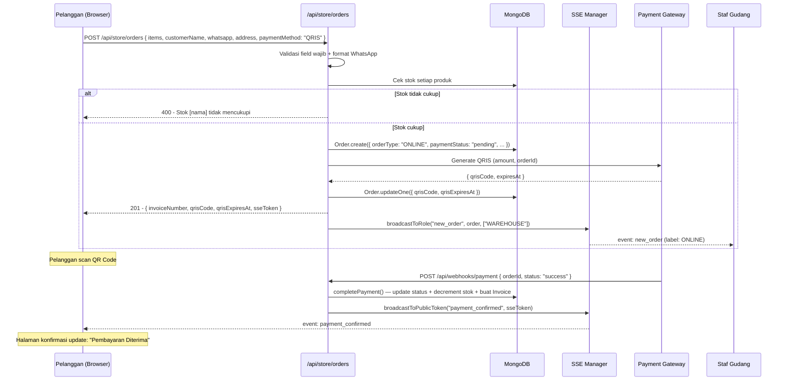
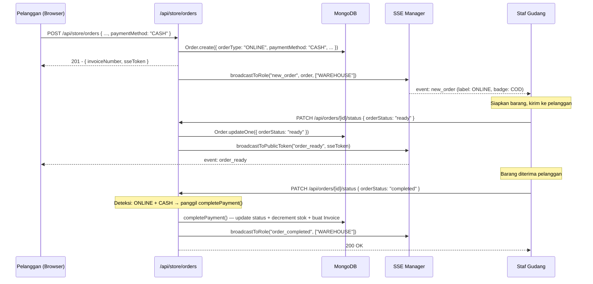

# Design Document — Layanan Pemesanan Online (Online Ordering)

## Overview

Fitur ini menambahkan kanal penjualan publik pada sistem POS yang sudah ada. Pelanggan mengakses halaman `/store`, memilih produk, mengisi data pengiriman, dan mengirimkan pesanan — tanpa login staf. Pesanan masuk ke antrean gudang yang sama dengan pesanan kasir, dibedakan dengan label `orderType`.

### Prinsip Desain

- **Minimal perubahan pada kode yang ada**: Ekstensi model `Order` dengan field baru, bukan model terpisah.
- **Reuse infrastruktur**: SSE Manager, `completePayment`, `generateQRIS`, dan `generateInvoiceNumber` yang sudah ada digunakan kembali tanpa modifikasi.
- **Keamanan by default**: Endpoint publik tidak memerlukan auth staf, tetapi divalidasi ketat dan dibatasi rate-nya.
- **Konsistensi UX**: Alur kerja gudang tidak berubah — hanya ada label tambahan dan filter baru.

---

## Architecture

### Alur Tingkat Tinggi

```
Pelanggan (Browser)
  │
  ├── GET /store                    → Katalog publik (RSC, no auth)
  ├── [Zustand/localStorage]        → Keranjang_Online (client-side)
  ├── POST /api/store/orders        → Buat Pesanan_Online (public API)
  ├── GET /store/order/[invoice]    → Halaman konfirmasi + status
  └── GET /api/sse/public?token=X  → SSE untuk update status pembayaran
                                      (token one-time per pesanan)

Staf Gudang (Browser)
  ├── GET /api/sse                  → SSE existing (terima new_order)
  └── PATCH /api/orders/[id]/status → Existing endpoint (tidak berubah)

Owner (Browser)
  └── GET /api/analytics            → Extended dengan segmentasi orderType
```

### Komponen Baru vs Modifikasi

| Komponen | Status | Keterangan |
|---|---|---|
| `src/app/store/` | **Baru** | Halaman publik (katalog, checkout, konfirmasi) |
| `src/app/api/store/orders/route.js` | **Baru** | Endpoint publik buat pesanan |
| `src/app/api/store/products/route.js` | **Baru** | Endpoint publik katalog produk |
| `src/app/api/sse/public/route.js` | **Baru** | SSE publik dengan token one-time |
| `src/models/Order.js` | **Modifikasi** | Tambah `orderType`, `whatsappNumber`, `shippingAddress` |
| `src/server/services/order.service.js` | **Modifikasi** | Tambah `createOnlineOrder()` |
| `src/components/warehouse/OrderQueueCard.jsx` | **Modifikasi** | Tambah label ONLINE/KASIR dan info pelanggan |
| `src/components/warehouse/OrderQueueList.jsx` | **Modifikasi** | Tambah filter berdasarkan `orderType` |
| `src/app/api/analytics/route.js` | **Modifikasi** | Segmentasi pendapatan online/offline |
| `src/app/api/reports/export/route.js` | **Modifikasi** | Tambah kolom `orderType`, `customerName`, dll. |
| `src/app/api/orders/[id]/status/route.js` | **Modifikasi** | Izinkan konfirmasi COD oleh WAREHOUSE |
| `middleware.js` | **Modifikasi** | Tambah rute `/store/*` sebagai public |

---

## Data Models

### Modifikasi Order Schema

Field baru yang ditambahkan ke `OrderSchema` yang sudah ada:

```javascript
// src/models/Order.js — field tambahan

orderType: {
  type: String,
  enum: ["OFFLINE", "ONLINE"],
  default: "OFFLINE",
},

// Data pelanggan online (null untuk pesanan offline)
customerWhatsapp: { type: String, default: null },  // format: 08xx atau +62xx
shippingAddress:  { type: String, default: null },

// COD confirmation (untuk pesanan ONLINE + CASH)
codConfirmedAt:   { type: Date, default: null },
codConfirmedBy:   { type: Schema.Types.ObjectId, ref: "User", default: null },
```

Field yang sudah ada dan tetap digunakan:
- `cashierId` — nullable untuk pesanan online (set ke `null`)
- `customerName` — sudah ada, digunakan untuk nama pelanggan online
- `invoiceNumber` — format sama `INV-YYYYMMDD-NNNN`
- `orderStatus` — enum yang sama, alur yang sama
- `paymentStatus` — enum yang sama
- `paymentMethod` — diperluas untuk pesanan online: `CASH` (COD), `QRIS`, `EWALLET_DANA`, `EWALLET_OVO`, `EWALLET_GOPAY`, `BANK_TRANSFER`

### Index Baru

```javascript
OrderSchema.index({ orderType: 1, orderStatus: 1 });
OrderSchema.index({ orderType: 1, createdAt: -1 });
```

### Modifikasi Invoice Schema

```javascript
// src/models/Invoice.js — field tambahan untuk pesanan online
customerName:     { type: String, default: null },
customerWhatsapp: { type: String, default: null },
shippingAddress:  { type: String, default: null },
orderType:        { type: String, enum: ["OFFLINE", "ONLINE"], default: "OFFLINE" },
```

### Entity Relationship (Perubahan)

```
Order (extended)
  ├── orderType: "OFFLINE" | "ONLINE"
  ├── cashierId: ObjectId | null        ← nullable untuk ONLINE
  ├── customerName: string | null
  ├── customerWhatsapp: string | null   ← baru
  ├── shippingAddress: string | null    ← baru
  └── codConfirmedBy: ObjectId | null   ← baru
```

---

## API Endpoints

### Endpoint Publik Baru

#### `GET /api/store/products`

Tidak memerlukan autentikasi. Mengembalikan produk aktif untuk katalog publik.

**Response 200:**
```json
{
  "data": [
    {
      "_id": "...",
      "name": "Kopi Arabika",
      "price": 25000,
      "stock": 100,
      "imageUrl": "https://..."
    }
  ],
  "total": 1
}
```

Field yang **tidak** dikembalikan: `sku`, `createdBy`, `isActive`, `updatedAt`.

Query params: `?search=<text>` untuk pencarian nama produk.

---

#### `POST /api/store/orders`

Tidak memerlukan autentikasi staf. Membuat Pesanan_Online baru.

**Request Body:**
```json
{
  "items": [
    { "productId": "...", "quantity": 2 }
  ],
  "customerName": "Budi Santoso",
  "customerWhatsapp": "081234567890",
  "shippingAddress": "Jl. Merdeka No. 1, Jakarta Pusat",
  "paymentMethod": "QRIS"
}
```

**Response 201:**
```json
{
  "data": {
    "_id": "...",
    "invoiceNumber": "INV-20260507-0042",
    "orderType": "ONLINE",
    "orderStatus": "waiting_preparation",
    "paymentStatus": "pending",
    "paymentMethod": "QRIS",
    "totalAmount": 50000,
    "customerName": "Budi Santoso",
    "shippingAddress": "Jl. Merdeka No. 1, Jakarta Pusat",
    "qrisCode": "...",
    "qrisExpiresAt": "2026-05-07T10:05:00.000Z",
    "sseToken": "one-time-token-uuid"
  }
}
```

**Response 400** (validasi gagal):
```json
{
  "error": {
    "code": "VALIDATION_ERROR",
    "message": "Nomor WhatsApp tidak valid"
  }
}
```

**Rate limiting**: 10 req/menit per IP. Response 429 jika terlampaui.

---

#### `GET /api/sse/public?token=<sseToken>`

SSE publik untuk Pelanggan memantau status pesanannya. Token one-time UUID yang digenerate saat pesanan dibuat, disimpan di `Order.sseToken` (hashed), expired setelah 24 jam.

**Events yang dikirim:**
- `payment_confirmed` — saat `paymentStatus` berubah ke `paid`
- `order_ready` — saat `orderStatus` berubah ke `ready`
- `qris_expired` — saat QRIS kedaluwarsa

---

### Modifikasi Endpoint yang Ada

#### `PATCH /api/orders/[id]/status`

Tambahan: izinkan WAREHOUSE mengubah status ke `completed` untuk pesanan ONLINE+CASH (konfirmasi COD).

```javascript
// Tambahan di ALLOWED_STATUSES untuk pesanan ONLINE+CASH
if (order.orderType === "ONLINE" && order.paymentMethod === "CASH" && orderStatus === "completed") {
  // Panggil completePayment() dengan method CASH, cashReceived: null
}
```

#### `GET /api/orders`

Tambahan query param: `?orderType=ONLINE|OFFLINE` untuk filter di halaman gudang.

#### `GET /api/analytics`

Response diperluas dengan segmentasi:

```json
{
  "summary": {
    "totalRevenue": 5250000,
    "offlineRevenue": 4000000,
    "onlineRevenue": 1250000,
    "totalOrders": 42,
    "offlineOrders": 30,
    "onlineOrders": 12,
    "averageOrderValue": 125000
  },
  "chart": [...]
}
```

---

## Halaman dan Komponen Baru

### Struktur Folder

```
src/
├── app/
│   └── store/
│       ├── layout.jsx                    # Layout publik (tanpa sidebar staf)
│       ├── page.jsx                      # Halaman katalog publik
│       ├── checkout/
│       │   └── page.jsx                  # Halaman checkout + form data pelanggan
│       └── order/
│           └── [invoiceNumber]/
│               └── page.jsx              # Halaman konfirmasi & status pesanan
├── components/
│   └── store/
│       ├── ProductGrid.jsx               # Grid produk katalog publik
│       ├── ProductCard.jsx               # Kartu produk individual
│       ├── CartDrawer.jsx                # Drawer keranjang (slide dari kanan)
│       ├── CartItem.jsx                  # Item di dalam drawer keranjang
│       ├── CheckoutForm.jsx              # Form data pelanggan + pilih pembayaran
│       ├── OrderConfirmation.jsx         # Halaman konfirmasi setelah checkout
│       ├── QrisPaymentDisplay.jsx        # Tampilan QR Code + countdown timer
│       └── OrderStatusBadge.jsx          # Badge status pesanan real-time
└── hooks/
    ├── useOnlineCart.js                  # Zustand store + localStorage sync
    └── useOrderStatus.js                 # SSE hook untuk status pesanan publik
```

### `useOnlineCart` Store

```javascript
// src/hooks/useOnlineCart.js
// Zustand store dengan persist ke localStorage

const useOnlineCart = create(
  persist(
    (set, get) => ({
      items: [],          // [{ productId, name, price, quantity, stock, imageUrl }]
      
      addItem: (product) => { /* tambah atau increment quantity */ },
      removeItem: (productId) => { /* hapus item */ },
      updateQuantity: (productId, quantity) => { /* set quantity */ },
      clearCart: () => set({ items: [] }),
      
      // Computed
      get totalAmount() { return get().items.reduce(...) },
      get totalItems() { return get().items.reduce(...) },
    }),
    { name: "online-cart-storage" }
  )
);
```

### `useOrderStatus` Hook

```javascript
// src/hooks/useOrderStatus.js
// SSE hook untuk halaman konfirmasi pesanan publik

export function useOrderStatus(invoiceNumber, sseToken, onEvent) {
  useEffect(() => {
    if (!sseToken) return;
    const es = new EventSource(`/api/sse/public?token=${sseToken}`);
    es.onmessage = (e) => {
      const event = JSON.parse(e.data);
      onEvent(event);
    };
    return () => es.close();
  }, [sseToken]);
}
```

---

## Alur Kerja Utama

### 1. Alur Pemesanan Online (QRIS)



### 2. Alur Pemesanan Online (COD)



### 3. Tampilan Antrean Gudang (Extended)

```
┌─────────────────────────────────────────────────────────┐
│  Antrean Gudang                    Filter: [Semua ▼]    │
│                                    □ Hanya Online        │
│                                    □ Hanya Kasir         │
├─────────────────────────────────────────────────────────┤
│  ┌─────────────────────────────────────────────────┐    │
│  │  🟢 ONLINE  │  INV-20260507-0042  │  10:32 WIB  │    │
│  │  Budi Santoso                                   │    │
│  │  📍 Jl. Merdeka No. 1, Jakarta Pusat            │    │
│  │  💳 QRIS — Lunas                                │    │
│  │  • Kopi Arabika × 2                             │    │
│  │  • Teh Hijau × 1                                │    │
│  │  Total: Rp 75.000                               │    │
│  │                    [Mulai Siapkan] [Tandai Siap] │    │
│  └─────────────────────────────────────────────────┘    │
│  ┌─────────────────────────────────────────────────┐    │
│  │  🔵 KASIR   │  INV-20260507-0041  │  10:28 WIB  │    │
│  │  Pelanggan Umum                                 │    │
│  │  • Kopi Robusta × 3                             │    │
│  │  Total: Rp 60.000                               │    │
│  │                    [Mulai Siapkan] [Tandai Siap] │    │
│  └─────────────────────────────────────────────────┘    │
└─────────────────────────────────────────────────────────┘
```

---

## Strategi SSE Publik

Pelanggan tidak memiliki sesi NextAuth, sehingga SSE publik menggunakan token one-time:

1. Saat `POST /api/store/orders` berhasil, server generate UUID token dan simpan di `Order.sseToken` (plain, tidak di-hash karena low-sensitivity).
2. Token dikembalikan ke Pelanggan dalam response body.
3. Pelanggan membuka `GET /api/sse/public?token=<token>`.
4. Server validasi token: cari `Order` dengan `sseToken` yang cocok, pastikan `createdAt` < 24 jam.
5. Server register koneksi SSE dengan key `sseToken` (bukan userId).
6. Saat status berubah, server broadcast ke token spesifik.

```javascript
// src/lib/sse.js — tambahan method
broadcastToToken(event, sseToken) {
  const payload = `data: ${JSON.stringify(event)}\n\n`;
  for (const [clientId, client] of this.clients.entries()) {
    if (client.sseToken === sseToken) {
      try { client.controller.enqueue(payload); }
      catch { this.unregister(clientId); }
    }
  }
}
```

---

## Validasi WhatsApp

Format yang diterima: `08xxxxxxxxxx` atau `+62xxxxxxxxxx` (10–15 digit total).

```javascript
// src/lib/validators.js
export function isValidWhatsapp(number) {
  return /^(\+62|08)\d{8,13}$/.test(number.trim());
}
```

---

## Rate Limiting

Implementasi sederhana menggunakan in-memory Map (kompatibel dengan single-instance deployment):

```javascript
// src/lib/rateLimit.js
const requestCounts = new Map(); // key: IP, value: { count, resetAt }

export function checkRateLimit(ip, maxRequests = 10, windowMs = 60_000) {
  const now = Date.now();
  const entry = requestCounts.get(ip);
  
  if (!entry || now > entry.resetAt) {
    requestCounts.set(ip, { count: 1, resetAt: now + windowMs });
    return { allowed: true };
  }
  
  if (entry.count >= maxRequests) {
    return { allowed: false, retryAfter: Math.ceil((entry.resetAt - now) / 1000) };
  }
  
  entry.count++;
  return { allowed: true };
}
```

---

## Metode Pembayaran Online

### Kategori Metode

| Kode | Kategori | Keterangan | Alur Konfirmasi |
|---|---|---|---|
| `CASH` | COD | Bayar tunai saat barang diterima | Manual oleh WAREHOUSE |
| `QRIS` | Digital | QR Code standar Indonesia | Webhook otomatis dari payment gateway |
| `EWALLET_DANA` | E-Wallet | Bayar via aplikasi DANA | Webhook otomatis dari payment gateway |
| `EWALLET_OVO` | E-Wallet | Bayar via aplikasi OVO | Webhook otomatis dari payment gateway |
| `EWALLET_GOPAY` | E-Wallet | Bayar via aplikasi GoPay | Webhook otomatis dari payment gateway |
| `BANK_TRANSFER` | Transfer Bank | Transfer ke rekening toko (BCA/Mandiri/BNI/BRI) | Manual oleh WAREHOUSE setelah verifikasi |

### Logika Pengelompokan

```javascript
// src/lib/paymentMethods.js
export const DIGITAL_PAYMENT_METHODS = ["QRIS", "EWALLET_DANA", "EWALLET_OVO", "EWALLET_GOPAY"];
export const MANUAL_PAYMENT_METHODS  = ["CASH", "BANK_TRANSFER"];

export function isDigitalPayment(method) {
  return DIGITAL_PAYMENT_METHODS.includes(method);
}

export function requiresManualConfirmation(method) {
  return MANUAL_PAYMENT_METHODS.includes(method);
}
```

### Alur per Kategori

- **QRIS & E-Wallet**: Payment gateway generate instruksi pembayaran → pelanggan bayar → webhook otomatis → `completePayment()` dipanggil
- **Bank Transfer**: Pelanggan transfer manual → WAREHOUSE verifikasi mutasi → klik "Konfirmasi Pembayaran" → `completePayment()` dipanggil
- **COD (CASH)**: Barang dikirim → pelanggan bayar tunai → WAREHOUSE klik "Konfirmasi COD" → `completePayment()` dipanggil

### Update Order Schema untuk Metode Baru

```javascript
// Tambahan di OrderSchema untuk bank transfer
bankTransferBank:    { type: String, default: null }, // "BCA" | "Mandiri" | "BNI" | "BRI"
bankTransferAccount: { type: String, default: null }, // nomor rekening toko
bankTransferConfirmedAt: { type: Date, default: null },
bankTransferConfirmedBy: { type: Schema.Types.ObjectId, ref: "User", default: null },
```

---

## Middleware Update

```javascript
// middleware.js — tambahan matcher untuk rute publik
export const config = {
  matcher: [
    // Rute yang memerlukan auth (existing)
    "/cashier/:path*",
    "/warehouse/:path*",
    "/owner/:path*",
    // /store/* TIDAK masuk matcher → tidak diproteksi auth
  ],
};
```

---

## Correctness Properties

### Property 1: Konsistensi Stok pada Penyelesaian Pembayaran Online

Untuk setiap Pesanan_Online yang berhasil diselesaikan, jumlah stok yang berkurang harus tepat sama dengan kuantitas yang dipesan, tidak lebih dan tidak kurang.

**Testable**: yes — property (invariant)

```javascript
// Untuk setiap item dalam pesanan yang selesai:
// stok_setelah = stok_sebelum - quantity_dipesan
// Berlaku untuk semua kombinasi item dan kuantitas
```

### Property 2: Idempoten Webhook Pembayaran

Mengirimkan webhook pembayaran yang sama dua kali tidak boleh mengubah state sistem lebih dari sekali.

**Testable**: yes — property (idempotence)

```javascript
// completePayment(orderId) dipanggil dua kali
// → hasil akhir sama dengan dipanggil satu kali
// → tidak ada double-decrement stok
// → tidak ada duplicate Invoice
```

### Property 3: Validasi Format WhatsApp

Fungsi `isValidWhatsapp` harus menerima semua format valid dan menolak semua format tidak valid secara konsisten.

**Testable**: yes — property (round-trip / error conditions)

```javascript
// isValidWhatsapp("081234567890") === true
// isValidWhatsapp("+6281234567890") === true
// isValidWhatsapp("1234") === false
// isValidWhatsapp("") === false
```

### Property 4: Integritas invoiceNumber

Setiap pesanan (online maupun offline) harus memiliki `invoiceNumber` yang unik di seluruh sistem.

**Testable**: yes — property (invariant)

```javascript
// Membuat N pesanan secara berurutan
// → semua invoiceNumber berbeda
// → format INV-YYYYMMDD-NNNN terpenuhi
```

### Property 5: Keamanan Data Pelanggan di SSE

Event SSE `new_order` yang dikirim ke WAREHOUSE tidak boleh mengandung `customerWhatsapp` dalam format plain text yang dapat disalahgunakan.

**Testable**: yes — example (security property)
