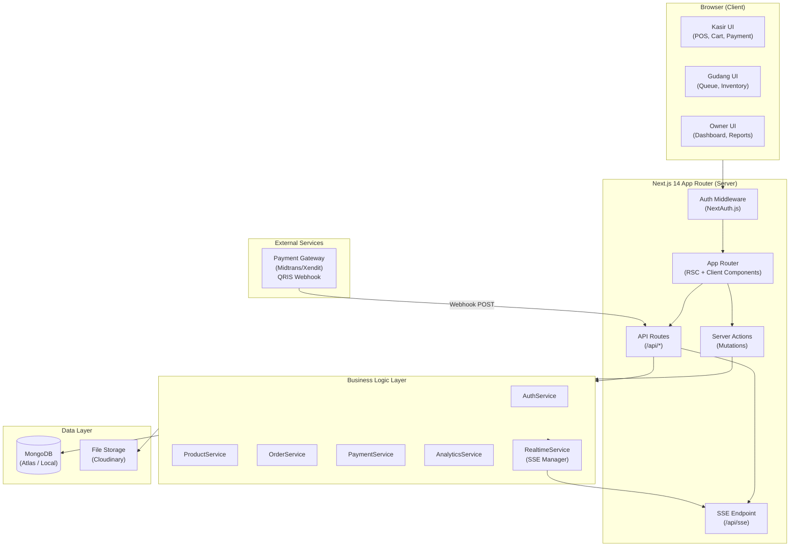
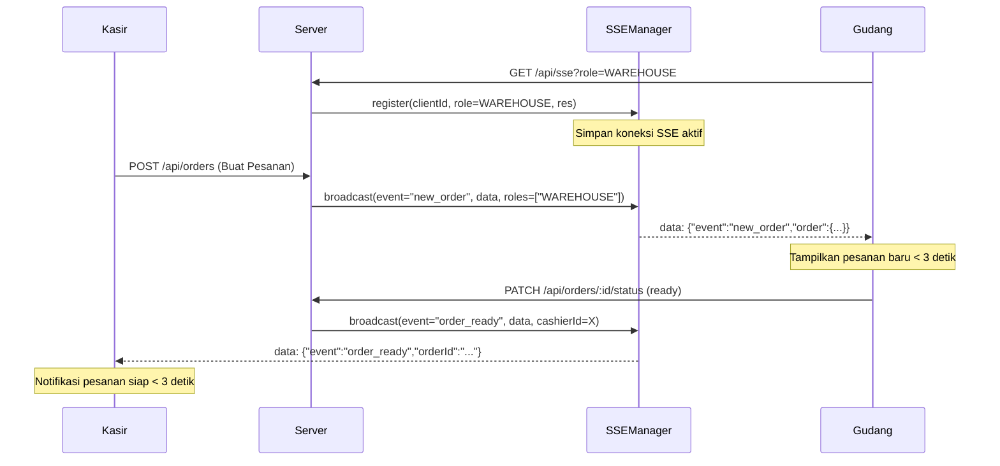
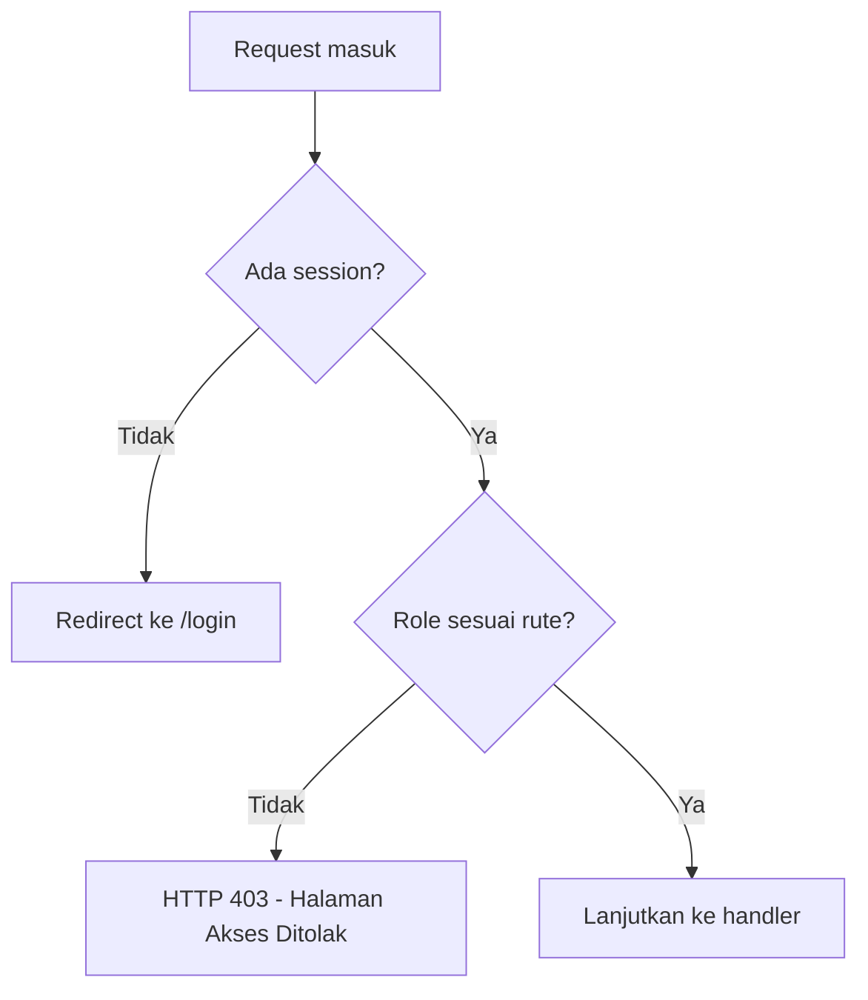
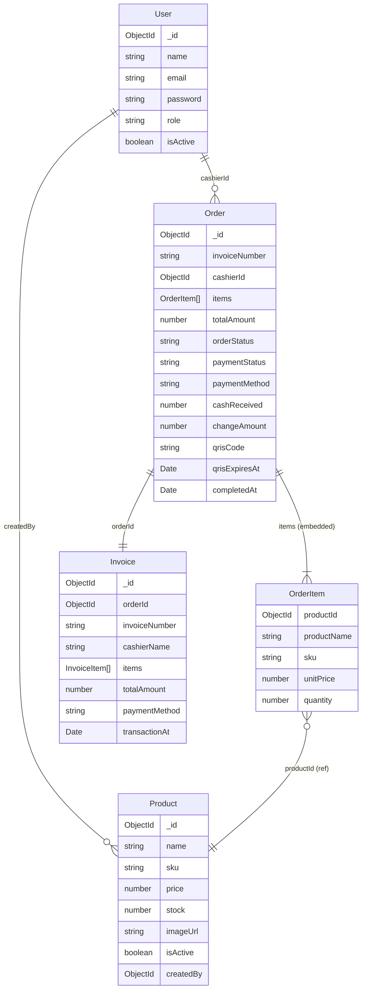
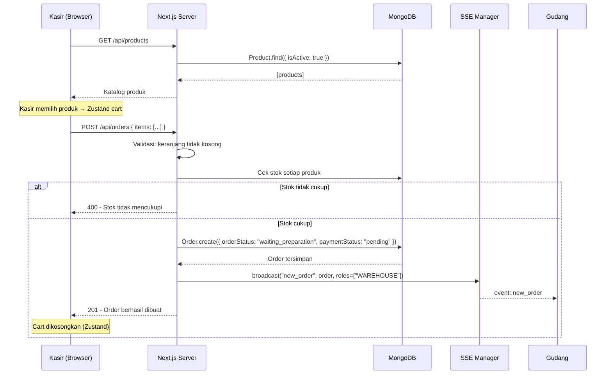
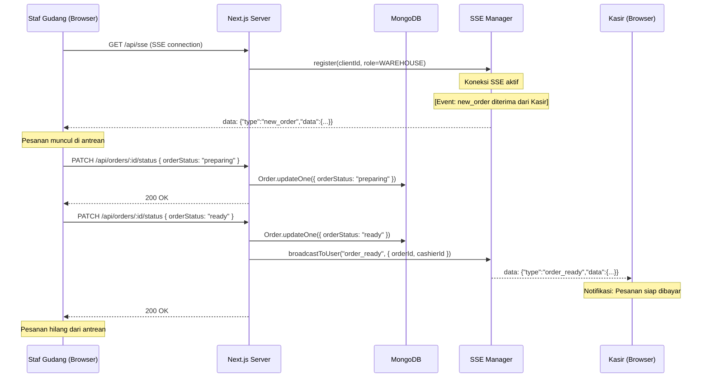
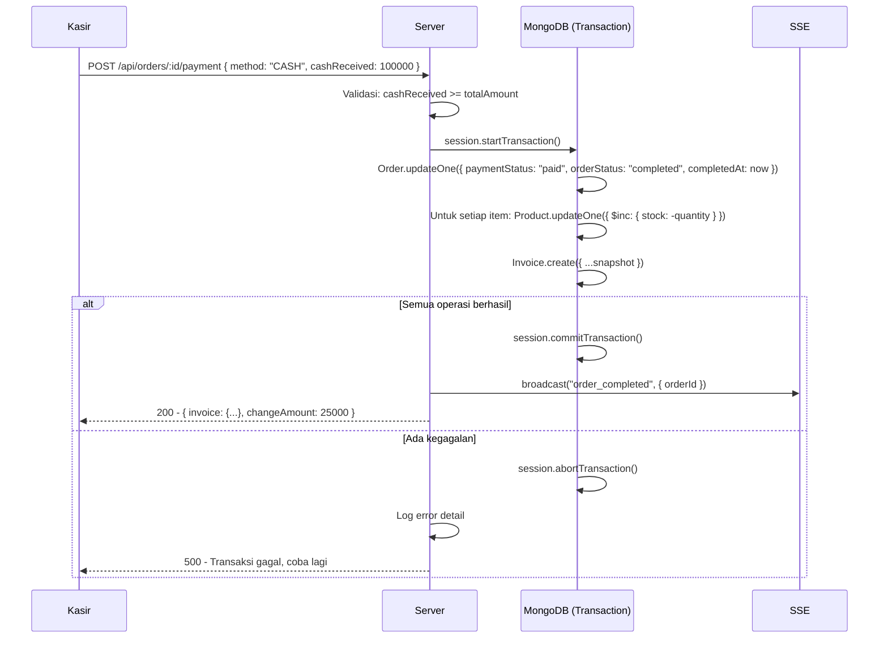
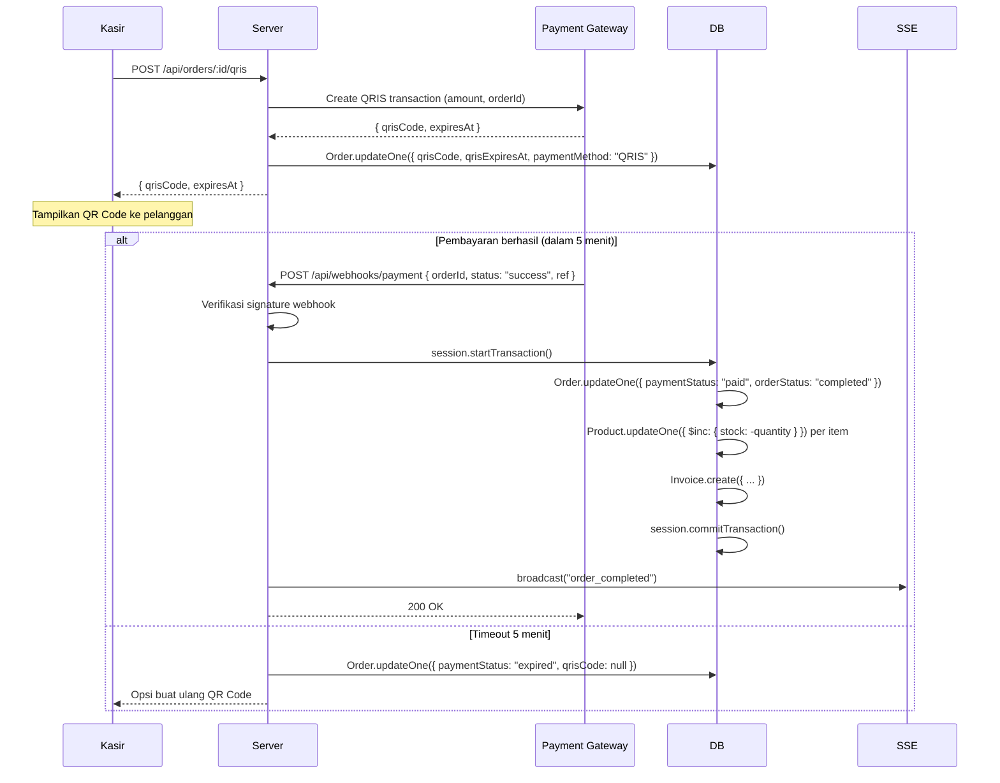
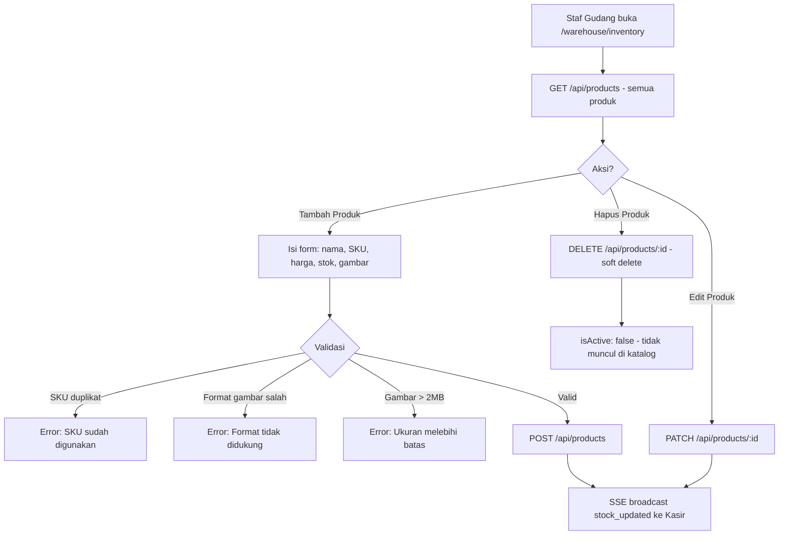

# Design Document: POS System

## Overview

Sistem Point of Sale (POS) berbasis web yang dibangun dengan Next.js 14 App Router. Sistem mendukung tiga peran pengguna — Kasir (`CASHIER`), Staf Gudang (`WAREHOUSE`), dan Pemilik (`OWNER`) — dengan alur transaksi yang mencakup pembuatan pesanan, persiapan barang, konfirmasi pembayaran, dan pelaporan analitik.

### Tujuan Desain

- **Konsistensi data**: Penyelesaian pembayaran dan pengurangan stok dilakukan dalam satu operasi atomik menggunakan Prisma transactions.
- **Real-time**: Perubahan status pesanan dan stok dipropagasi ke semua klien yang relevan dalam < 3 detik menggunakan Server-Sent Events (SSE).
- **Keamanan berbasis peran**: Setiap rute dilindungi di sisi server menggunakan NextAuth.js middleware; klien tidak pernah menjadi satu-satunya penjaga akses.
- **Integritas historis**: Produk tidak pernah dihapus secara permanen (soft delete) sehingga data pesanan lama tetap valid.

### Keputusan Teknologi Utama

| Layer | Pilihan | Alasan |
|---|---|---|
| Framework | Next.js 14 App Router | SSR, Server Actions, middleware routing bawaan |
| Database | MongoDB dengan Mongoose | Fleksibel untuk dokumen produk, mendukung transaksi multi-dokumen |
| ORM/ODM | Mongoose | Skema yang kuat, middleware hooks, dukungan transaksi |
| Auth | NextAuth.js v5 | Integrasi Next.js native, JWT dengan role claims |
| Real-time | Server-Sent Events (SSE) | Unidirectional push dari server ke klien, tidak memerlukan WebSocket server terpisah |
| State (Cart) | Zustand | Ringan, persisten di sisi klien, tidak memerlukan server |
| UI | Tailwind CSS + shadcn/ui | Komponen aksesibel, konsisten, dan mudah dikustomisasi |
| File Storage | Cloudinary / local `public/uploads` | Upload gambar produk dengan validasi format dan ukuran |
| Payment | QRIS via payment gateway (Midtrans/Xendit) | Standar QRIS Indonesia, webhook untuk konfirmasi otomatis |

> **Catatan MongoDB vs PostgreSQL**: Meskipun steering file menyebut PostgreSQL, pengguna secara eksplisit memilih MongoDB. MongoDB mendukung multi-document transactions sejak versi 4.0, sehingga operasi atomik tetap dapat dijamin menggunakan `session.withTransaction()`.


---

## Architecture

### High-Level Architecture



### Arsitektur Real-Time (SSE)



### Alur Autentikasi dan Otorisasi



Middleware NextAuth.js di `middleware.ts` menginspeksi JWT token pada setiap request. Mapping rute ke role:

| Prefix Rute | Role yang Diizinkan |
|---|---|
| `/cashier/*` | `CASHIER` |
| `/warehouse/*` | `WAREHOUSE` |
| `/owner/*` | `OWNER` |
| `/api/products` (POST/PATCH/DELETE) | `WAREHOUSE` |
| `/api/orders` (POST) | `CASHIER` |
| `/api/analytics/*` | `OWNER` |


---

## Components and Interfaces

### Struktur Folder Proyek

```
/
├── src/
│   ├── app/
│   │   ├── (auth)/
│   │   │   └── login/
│   │   │       └── page.tsx              # Halaman login
│   │   ├── cashier/
│   │   │   ├── layout.tsx                # Layout Kasir (role guard)
│   │   │   ├── page.tsx                  # POS utama (katalog + keranjang)
│   │   │   ├── orders/
│   │   │   │   └── page.tsx              # Daftar pesanan aktif Kasir
│   │   │   └── payment/
│   │   │       └── [orderId]/
│   │   │           └── page.tsx          # Halaman pembayaran
│   │   ├── warehouse/
│   │   │   ├── layout.tsx                # Layout Gudang (role guard)
│   │   │   ├── queue/
│   │   │   │   └── page.tsx              # Antrean real-time
│   │   │   └── inventory/
│   │   │       └── page.tsx              # Manajemen produk & stok
│   │   ├── owner/
│   │   │   ├── layout.tsx                # Layout Owner (role guard)
│   │   │   └── dashboard/
│   │   │       └── page.tsx              # Dashboard analitik
│   │   └── api/
│   │       ├── auth/
│   │       │   └── [...nextauth]/
│   │       │       └── route.ts          # NextAuth handler
│   │       ├── products/
│   │       │   ├── route.ts              # GET (list), POST (create)
│   │       │   └── [id]/
│   │       │       └── route.ts          # GET, PATCH, DELETE (soft)
│   │       ├── orders/
│   │       │   ├── route.ts              # GET (list), POST (create)
│   │       │   └── [id]/
│   │       │       ├── route.ts          # GET detail
│   │       │       ├── status/
│   │       │       │   └── route.ts      # PATCH orderStatus
│   │       │       └── payment/
│   │       │           └── route.ts      # POST konfirmasi pembayaran
│   │       ├── analytics/
│   │       │   └── route.ts              # GET metrics + chart data
│   │       ├── reports/
│   │       │   └── export/
│   │       │       └── route.ts          # GET CSV export
│   │       ├── webhooks/
│   │       │   └── payment/
│   │       │       └── route.ts          # POST webhook dari payment gateway
│   │       └── sse/
│   │           └── route.ts              # GET SSE stream
│   ├── components/
│   │   ├── ui/                           # shadcn/ui primitives
│   │   ├── auth/
│   │   │   └── LoginForm.tsx
│   │   ├── cashier/
│   │   │   ├── ProductCatalog.tsx        # Grid produk
│   │   │   ├── CartPanel.tsx             # Panel keranjang kanan
│   │   │   ├── CartItem.tsx
│   │   │   ├── OrderReadyNotification.tsx
│   │   │   └── PaymentModal.tsx          # Modal Cash / QRIS
│   │   ├── warehouse/
│   │   │   ├── OrderQueueCard.tsx        # Kartu pesanan di antrean
│   │   │   ├── OrderQueueList.tsx
│   │   │   ├── ProductTable.tsx          # Tabel inventori
│   │   │   └── ProductFormModal.tsx      # Form tambah/edit produk
│   │   └── owner/
│   │       ├── MetricCards.tsx           # Kartu ringkasan metrik
│   │       ├── RevenueChart.tsx          # Grafik pendapatan (Recharts)
│   │       └── DateRangePicker.tsx
│   ├── lib/
│   │   ├── auth.ts                       # NextAuth config & helpers
│   │   ├── db.ts                         # Mongoose connection singleton
│   │   ├── sse.ts                        # SSE Manager (in-memory map)
│   │   ├── invoice.ts                    # Invoice number generator
│   │   └── utils.ts                      # cn(), formatRupiah(), dll.
│   ├── server/
│   │   ├── actions/
│   │   │   ├── product.actions.ts        # Server Actions produk
│   │   │   ├── order.actions.ts          # Server Actions pesanan
│   │   │   └── payment.actions.ts        # Server Actions pembayaran
│   │   └── services/
│   │       ├── product.service.ts
│   │       ├── order.service.ts
│   │       ├── payment.service.ts
│   │       └── analytics.service.ts
│   ├── models/                           # Mongoose models
│   │   ├── User.ts
│   │   ├── Product.ts
│   │   ├── Order.ts
│   │   └── Invoice.ts
│   ├── types/
│   │   ├── index.ts                      # Re-exports
│   │   ├── order.types.ts
│   │   ├── product.types.ts
│   │   └── auth.types.ts
│   └── hooks/
│       ├── useSSE.ts                     # Hook koneksi SSE
│       ├── useCart.ts                    # Zustand cart store
│       └── useOrderQueue.ts              # Hook antrean gudang
├── public/
│   └── uploads/                          # Fallback local image storage
└── tests/
    ├── unit/
    │   ├── services/
    │   └── utils/
    ├── integration/
    └── property/                         # Property-based tests (fast-check)
```

### Komponen Kunci dan Interface

#### SSE Manager (`src/lib/sse.ts`)

```typescript
interface SSEClient {
  id: string;
  role: UserRole;
  userId: string;
  response: Response; // Next.js ReadableStream controller
}

interface SSEManager {
  register(client: SSEClient): void;
  unregister(clientId: string): void;
  broadcast(event: SSEEvent): void;
  broadcastToRole(event: SSEEvent, roles: UserRole[]): void;
  broadcastToUser(event: SSEEvent, userId: string): void;
}

type SSEEvent =
  | { type: "new_order"; data: OrderSummary }
  | { type: "order_ready"; data: { orderId: string; invoiceNumber: string; cashierId: string } }
  | { type: "order_completed"; data: { orderId: string } }
  | { type: "stock_updated"; data: { productId: string; newStock: number } }
  | { type: "product_updated"; data: ProductSummary };
```

#### Cart Store (`src/hooks/useCart.ts`)

```typescript
interface CartItem {
  productId: string;
  name: string;
  price: number; // dalam rupiah (integer)
  quantity: number;
  stock: number;
  imageUrl?: string;
}

interface CartStore {
  items: CartItem[];
  addItem(product: Product): void;
  removeItem(productId: string): void;
  updateQuantity(productId: string, quantity: number): void;
  clearCart(): void;
  totalAmount: number; // computed
  totalItems: number;  // computed
}
```


---

## Data Models

### Mongoose Schemas

#### User

```typescript
// src/models/User.ts
const UserSchema = new Schema({
  name:      { type: String, required: true },
  email:     { type: String, required: true, unique: true, lowercase: true },
  password:  { type: String, required: true },  // bcrypt hash
  role:      { type: String, enum: ["CASHIER", "WAREHOUSE", "OWNER"], required: true },
  isActive:  { type: Boolean, default: true },
  createdAt: { type: Date, default: Date.now },
  updatedAt: { type: Date, default: Date.now },
});
```

#### Product

```typescript
// src/models/Product.ts
const ProductSchema = new Schema({
  name:      { type: String, required: true },
  sku:       { type: String, required: true, unique: true, uppercase: true },
  price:     { type: Number, required: true, min: 0 },  // integer rupiah
  stock:     { type: Number, required: true, min: 0, default: 0 },
  imageUrl:  { type: String, default: null },
  isActive:  { type: Boolean, default: true },          // soft delete flag
  createdBy: { type: Schema.Types.ObjectId, ref: "User", required: true },
  createdAt: { type: Date, default: Date.now },
  updatedAt: { type: Date, default: Date.now },
});

// Index untuk pencarian dan filter
ProductSchema.index({ name: "text" });
ProductSchema.index({ sku: 1 });
ProductSchema.index({ isActive: 1 });
```

#### Order

```typescript
// src/models/Order.ts
const OrderItemSchema = new Schema({
  productId:  { type: Schema.Types.ObjectId, ref: "Product", required: true },
  productName: { type: String, required: true },  // snapshot saat order dibuat
  sku:        { type: String, required: true },
  unitPrice:  { type: Number, required: true },   // snapshot harga saat order
  quantity:   { type: Number, required: true, min: 1 },
});

const OrderSchema = new Schema({
  invoiceNumber: { type: String, required: true, unique: true },
  // Format: INV-YYYYMMDD-NNNN (e.g., INV-20260507-0001)

  cashierId:  { type: Schema.Types.ObjectId, ref: "User", required: true },
  items:      { type: [OrderItemSchema], required: true },
  totalAmount: { type: Number, required: true, min: 0 },  // integer rupiah

  orderStatus: {
    type: String,
    enum: ["waiting_preparation", "preparing", "ready", "completed", "cancelled"],
    default: "waiting_preparation",
  },
  paymentStatus: {
    type: String,
    enum: ["pending", "paid", "expired"],
    default: "pending",
  },
  paymentMethod: {
    type: String,
    enum: ["CASH", "QRIS", null],
    default: null,
  },

  // CASH payment fields
  cashReceived: { type: Number, default: null },
  changeAmount: { type: Number, default: null },

  // QRIS payment fields
  qrisCode:      { type: String, default: null },
  qrisExpiresAt: { type: Date, default: null },
  qrisPaymentRef: { type: String, default: null }, // referensi dari payment gateway

  createdAt: { type: Date, default: Date.now },
  updatedAt: { type: Date, default: Date.now },
  completedAt: { type: Date, default: null },
});

OrderSchema.index({ cashierId: 1, orderStatus: 1 });
OrderSchema.index({ orderStatus: 1 });
OrderSchema.index({ createdAt: -1 });
OrderSchema.index({ invoiceNumber: 1 });
```

#### Invoice

```typescript
// src/models/Invoice.ts
const InvoiceSchema = new Schema({
  orderId:       { type: Schema.Types.ObjectId, ref: "Order", required: true, unique: true },
  invoiceNumber: { type: String, required: true, unique: true },
  cashierName:   { type: String, required: true },  // snapshot nama kasir
  items: [{
    productName: String,
    sku:         String,
    unitPrice:   Number,
    quantity:    Number,
    subtotal:    Number,
  }],
  totalAmount:    { type: Number, required: true },
  paymentMethod:  { type: String, enum: ["CASH", "QRIS"], required: true },
  cashReceived:   { type: Number, default: null },
  changeAmount:   { type: Number, default: null },
  transactionAt:  { type: Date, required: true },
  createdAt:      { type: Date, default: Date.now },
});
```

### Relasi Antar Entitas



### Catatan Desain Data

- **Snapshot harga dan nama produk**: `OrderItem` menyimpan `productName`, `sku`, dan `unitPrice` pada saat pesanan dibuat. Ini memastikan data historis tidak berubah meskipun produk diperbarui atau dinonaktifkan.
- **Nilai moneter sebagai integer**: Semua harga dan total disimpan dalam satuan rupiah (integer) untuk menghindari masalah floating-point.
- **Invoice sebagai dokumen terpisah**: Invoice dibuat setelah transaksi selesai dan menyimpan snapshot lengkap, sehingga dapat dirender tanpa join ke Order.


---

## API Endpoints

### Autentikasi

| Method | Path | Role | Deskripsi |
|---|---|---|---|
| `POST` | `/api/auth/signin` | Public | Login via NextAuth credentials provider |
| `POST` | `/api/auth/signout` | Authenticated | Logout, hapus sesi |
| `GET` | `/api/auth/session` | Authenticated | Ambil data sesi aktif |

### Produk

| Method | Path | Role | Deskripsi |
|---|---|---|---|
| `GET` | `/api/products` | CASHIER, WAREHOUSE | List produk aktif (katalog). Query: `?search=`, `?sku=` |
| `POST` | `/api/products` | WAREHOUSE | Buat produk baru |
| `GET` | `/api/products/:id` | WAREHOUSE | Detail produk |
| `PATCH` | `/api/products/:id` | WAREHOUSE | Update nama, harga, gambar, atau stok |
| `DELETE` | `/api/products/:id` | WAREHOUSE | Soft delete (set `isActive: false`) |
| `POST` | `/api/products/:id/image` | WAREHOUSE | Upload gambar produk (multipart/form-data) |

**Request Body — POST `/api/products`:**
```json
{
  "name": "Kopi Arabika",
  "sku": "KOP-001",
  "price": 25000,
  "stock": 100,
  "imageUrl": "https://..."
}
```

**Response — GET `/api/products`:**
```json
{
  "data": [
    {
      "_id": "...",
      "name": "Kopi Arabika",
      "sku": "KOP-001",
      "price": 25000,
      "stock": 100,
      "imageUrl": "https://...",
      "isActive": true
    }
  ],
  "total": 1
}
```

### Pesanan

| Method | Path | Role | Deskripsi |
|---|---|---|---|
| `POST` | `/api/orders` | CASHIER | Buat pesanan baru dari keranjang |
| `GET` | `/api/orders` | CASHIER, WAREHOUSE | List pesanan. Query: `?status=`, `?cashierId=` |
| `GET` | `/api/orders/:id` | CASHIER, WAREHOUSE | Detail pesanan |
| `PATCH` | `/api/orders/:id/status` | WAREHOUSE | Update `orderStatus` (e.g., `preparing` → `ready`) |
| `POST` | `/api/orders/:id/payment` | CASHIER | Konfirmasi pembayaran Cash |
| `POST` | `/api/orders/:id/qris` | CASHIER | Generate kode QRIS untuk pesanan |

**Request Body — POST `/api/orders`:**
```json
{
  "items": [
    { "productId": "...", "quantity": 2 },
    { "productId": "...", "quantity": 1 }
  ]
}
```

**Response — POST `/api/orders`:**
```json
{
  "data": {
    "_id": "...",
    "invoiceNumber": "INV-20260507-0001",
    "orderStatus": "waiting_preparation",
    "paymentStatus": "pending",
    "totalAmount": 75000,
    "items": [...]
  }
}
```

**Request Body — POST `/api/orders/:id/payment` (Cash):**
```json
{
  "method": "CASH",
  "cashReceived": 100000
}
```

### Analitik & Laporan

| Method | Path | Role | Deskripsi |
|---|---|---|---|
| `GET` | `/api/analytics` | OWNER | Metrik ringkasan + data grafik. Query: `?range=daily\|weekly\|monthly` |
| `GET` | `/api/reports/export` | OWNER | Download CSV pesanan selesai. Query: `?range=`, `?from=`, `?to=` |

**Response — GET `/api/analytics?range=weekly`:**
```json
{
  "summary": {
    "totalRevenue": 5250000,
    "totalOrders": 42,
    "averageOrderValue": 125000
  },
  "chart": [
    { "date": "2026-05-01", "revenue": 750000 },
    { "date": "2026-05-02", "revenue": 820000 }
  ]
}
```

### SSE & Webhook

| Method | Path | Role | Deskripsi |
|---|---|---|---|
| `GET` | `/api/sse` | CASHIER, WAREHOUSE | Buka koneksi SSE untuk real-time events |
| `POST` | `/api/webhooks/payment` | System (Payment GW) | Terima notifikasi konfirmasi QRIS |


---

## Workflow Utama

### 1. Alur Pembuatan Pesanan (Kasir)



### 2. Alur Antrean Gudang (Real-Time)



### 3. Alur Pembayaran Cash (Atomik)



### 4. Alur Pembayaran QRIS



### 5. Alur Manajemen Produk (Gudang)




---

## Strategi Real-Time (SSE)

### Implementasi SSE Manager

SSE Manager adalah singleton in-memory yang menyimpan semua koneksi SSE aktif. Karena Next.js App Router berjalan di Node.js, singleton ini aman digunakan selama aplikasi berjalan dalam satu proses (single instance). Untuk deployment multi-instance, perlu diganti dengan Redis Pub/Sub.

```typescript
// src/lib/sse.ts
class SSEManager {
  private clients = new Map<string, SSEClient>();

  register(client: SSEClient) {
    this.clients.set(client.id, client);
  }

  unregister(clientId: string) {
    this.clients.delete(clientId);
  }

  broadcastToRole(event: SSEEvent, roles: UserRole[]) {
    const payload = `data: ${JSON.stringify(event)}\n\n`;
    for (const client of this.clients.values()) {
      if (roles.includes(client.role)) {
        client.controller.enqueue(payload);
      }
    }
  }

  broadcastToUser(event: SSEEvent, userId: string) {
    const payload = `data: ${JSON.stringify(event)}\n\n`;
    const client = [...this.clients.values()].find(c => c.userId === userId);
    client?.controller.enqueue(payload);
  }
}

export const sseManager = new SSEManager();
```

### SSE Route Handler

```typescript
// src/app/api/sse/route.ts
export async function GET(req: Request) {
  const session = await getServerSession();
  if (!session) return new Response(null, { status: 401 });

  const clientId = crypto.randomUUID();
  const stream = new ReadableStream({
    start(controller) {
      sseManager.register({ id: clientId, role: session.user.role, userId: session.user.id, controller });
      // Heartbeat setiap 30 detik untuk mencegah timeout
      const heartbeat = setInterval(() => controller.enqueue(": heartbeat\n\n"), 30000);
      req.signal.addEventListener("abort", () => {
        clearInterval(heartbeat);
        sseManager.unregister(clientId);
      });
    },
  });

  return new Response(stream, {
    headers: {
      "Content-Type": "text/event-stream",
      "Cache-Control": "no-cache",
      "Connection": "keep-alive",
    },
  });
}
```

### Client Hook

```typescript
// src/hooks/useSSE.ts
export function useSSE(onEvent: (event: SSEEvent) => void) {
  useEffect(() => {
    const es = new EventSource("/api/sse");
    es.onmessage = (e) => {
      const event = JSON.parse(e.data) as SSEEvent;
      onEvent(event);
    };
    return () => es.close();
  }, []);
}
```

### Event yang Di-broadcast

| Event Type | Dikirim Ke | Trigger |
|---|---|---|
| `new_order` | `WAREHOUSE` | Kasir berhasil membuat pesanan |
| `order_ready` | Kasir spesifik (by userId) | Gudang menandai pesanan `ready` |
| `order_completed` | `CASHIER` | Pembayaran berhasil dikonfirmasi |
| `stock_updated` | `CASHIER` | Gudang mengupdate stok produk |
| `product_updated` | `CASHIER` | Gudang mengupdate data produk |

---

## Strategi Transaksi Atomik

### Implementasi dengan Mongoose Session

Operasi penyelesaian pembayaran menggunakan MongoDB multi-document transaction untuk menjamin atomisitas:

```typescript
// src/server/services/payment.service.ts
export async function completePayment(orderId: string, paymentData: PaymentData) {
  const mongoSession = await mongoose.startSession();
  
  try {
    await mongoSession.withTransaction(async () => {
      const order = await Order.findById(orderId).session(mongoSession);
      if (!order || order.paymentStatus !== "pending") {
        throw new Error("Order tidak valid atau sudah diproses");
      }

      // 1. Update status pesanan
      await Order.updateOne(
        { _id: orderId },
        {
          $set: {
            paymentStatus: "paid",
            orderStatus: "completed",
            paymentMethod: paymentData.method,
            cashReceived: paymentData.cashReceived ?? null,
            changeAmount: paymentData.changeAmount ?? null,
            completedAt: new Date(),
          },
        },
        { session: mongoSession }
      );

      // 2. Kurangi stok setiap produk (bulk write untuk efisiensi)
      const stockUpdates = order.items.map((item) => ({
        updateOne: {
          filter: { _id: item.productId, stock: { $gte: item.quantity } },
          update: { $inc: { stock: -item.quantity } },
        },
      }));
      const bulkResult = await Product.bulkWrite(stockUpdates, { session: mongoSession });
      
      if (bulkResult.modifiedCount !== order.items.length) {
        throw new Error("Stok tidak mencukupi untuk satu atau lebih produk");
      }

      // 3. Buat invoice
      const cashier = await User.findById(order.cashierId).session(mongoSession);
      await Invoice.create([{
        orderId: order._id,
        invoiceNumber: order.invoiceNumber,
        cashierName: cashier!.name,
        items: order.items.map((i) => ({
          productName: i.productName,
          sku: i.sku,
          unitPrice: i.unitPrice,
          quantity: i.quantity,
          subtotal: i.unitPrice * i.quantity,
        })),
        totalAmount: order.totalAmount,
        paymentMethod: paymentData.method,
        cashReceived: paymentData.cashReceived ?? null,
        changeAmount: paymentData.changeAmount ?? null,
        transactionAt: new Date(),
      }], { session: mongoSession });
    });

    // Broadcast SSE setelah commit berhasil
    sseManager.broadcastToRole({ type: "order_completed", data: { orderId } }, ["CASHIER", "WAREHOUSE"]);
    
    return { success: true };
  } catch (error) {
    // withTransaction otomatis melakukan abort jika throw
    logger.error("Payment completion failed", { orderId, error });
    throw error;
  } finally {
    mongoSession.endSession();
  }
}
```

### Jaminan Atomisitas

- `session.withTransaction()` secara otomatis melakukan `commitTransaction()` jika tidak ada error, atau `abortTransaction()` jika ada exception.
- Filter `stock: { $gte: item.quantity }` pada bulk write memastikan stok tidak bisa menjadi negatif.
- Jika `modifiedCount` tidak sama dengan jumlah item, transaksi di-abort dan error dikembalikan ke klien.
- Semua operasi (update order, update stok, create invoice) terjadi dalam satu session yang sama.


---

## Error Handling

### Strategi Umum

Semua API routes mengembalikan respons JSON dengan format konsisten:

```typescript
// Sukses
{ "data": {...}, "message": "..." }

// Error
{ "error": { "code": "ERROR_CODE", "message": "Pesan yang dapat ditampilkan ke pengguna" } }
```

### Error Codes dan HTTP Status

| HTTP Status | Error Code | Kondisi |
|---|---|---|
| `400` | `VALIDATION_ERROR` | Input tidak valid (field kosong, format salah) |
| `400` | `EMPTY_CART` | Kasir mencoba membuat pesanan dengan keranjang kosong |
| `400` | `INSUFFICIENT_STOCK` | Stok produk tidak mencukupi saat buat pesanan |
| `400` | `DUPLICATE_SKU` | SKU produk sudah digunakan |
| `400` | `INVALID_IMAGE_FORMAT` | Format gambar bukan JPG/PNG/WEBP |
| `400` | `IMAGE_TOO_LARGE` | Ukuran gambar melebihi 2MB |
| `400` | `INSUFFICIENT_CASH` | Uang tunai yang diterima kurang dari total |
| `401` | `UNAUTHORIZED` | Tidak ada sesi aktif |
| `403` | `FORBIDDEN` | Role tidak memiliki akses ke rute ini |
| `404` | `NOT_FOUND` | Resource tidak ditemukan |
| `409` | `QRIS_EXPIRED` | Kode QRIS sudah kedaluwarsa |
| `500` | `TRANSACTION_FAILED` | Operasi atomik gagal (rollback dilakukan) |
| `500` | `INTERNAL_ERROR` | Error server tidak terduga |

### Error Handling di Server Actions

```typescript
// src/server/actions/order.actions.ts
export async function createOrder(formData: CreateOrderInput) {
  try {
    const session = await getServerSession();
    if (!session || session.user.role !== "CASHIER") {
      return { error: { code: "FORBIDDEN", message: "Akses ditolak" } };
    }
    
    if (!formData.items || formData.items.length === 0) {
      return { error: { code: "EMPTY_CART", message: "Keranjang belanja kosong" } };
    }

    const result = await orderService.createOrder(session.user.id, formData.items);
    return { data: result };
  } catch (error) {
    if (error instanceof InsufficientStockError) {
      return { error: { code: "INSUFFICIENT_STOCK", message: error.message } };
    }
    logger.error("createOrder failed", { error });
    return { error: { code: "INTERNAL_ERROR", message: "Terjadi kesalahan, coba lagi" } };
  }
}
```

### Penanganan QRIS Timeout

Sebuah background job (atau cron via Vercel Cron / node-cron) berjalan setiap menit untuk menandai pesanan QRIS yang kedaluwarsa:

```typescript
// Cek pesanan dengan qrisExpiresAt < now dan paymentStatus: "pending"
await Order.updateMany(
  { paymentStatus: "pending", qrisExpiresAt: { $lt: new Date() } },
  { $set: { paymentStatus: "expired", qrisCode: null } }
);
```

### Logging

Semua error level `ERROR` dan `WARN` dicatat menggunakan `pino` atau `winston` dengan konteks:
- `orderId`, `userId`, `action`, `errorMessage`, `stack`
- Di production: dikirim ke layanan logging (Datadog, Sentry, atau CloudWatch)


---

## Correctness Properties

*A property is a characteristic or behavior that should hold true across all valid executions of a system — essentially, a formal statement about what the system should do. Properties serve as the bridge between human-readable specifications and machine-verifiable correctness guarantees.*

### Property 1: Role-Based Access Control

*For any* kombinasi (role pengguna, rute yang diakses) di mana role tersebut tidak memiliki izin untuk rute tersebut, sistem SHALL mengembalikan HTTP 403 tanpa mengeksekusi logika bisnis apapun.

**Validates: Requirements 1.5, 1.6**

---

### Property 2: Redirect ke Login untuk Unauthenticated Request

*For any* protected route yang diakses tanpa sesi autentikasi yang valid, sistem SHALL mengembalikan redirect ke halaman login (HTTP 302 ke `/login`).

**Validates: Requirements 1.4**

---

### Property 3: Login Redirect Sesuai Role

*For any* pengguna dengan role yang valid (CASHIER, WAREHOUSE, atau OWNER) yang berhasil login, sistem SHALL mengarahkan pengguna ke halaman yang sesuai dengan rolenya (CASHIER → `/cashier`, WAREHOUSE → `/warehouse/queue`, OWNER → `/owner/dashboard`).

**Validates: Requirements 1.2**

---

### Property 4: Kredensial Invalid Mengembalikan Pesan Generik

*For any* kombinasi email dan password yang tidak valid (email tidak terdaftar, atau password salah), sistem SHALL mengembalikan pesan error yang sama ("Email atau kata sandi salah") tanpa mengungkap apakah email terdaftar atau tidak.

**Validates: Requirements 1.3**

---

### Property 5: SKU Unik — Duplikat Ditolak

*For any* produk yang sudah ada di database, mencoba membuat produk baru dengan SKU yang sama SHALL selalu ditolak dengan error `DUPLICATE_SKU`, terlepas dari nilai field lainnya.

**Validates: Requirements 2.2**

---

### Property 6: Update Produk Persisten (Round-Trip)

*For any* update data produk yang valid (nama, harga, atau stok), setelah operasi update berhasil, membaca produk tersebut dari database SHALL mengembalikan nilai yang sama dengan yang dikirim dalam request update.

**Validates: Requirements 2.3, 2.4**

---

### Property 7: Validasi Format dan Ukuran Gambar

*For any* file yang diunggah sebagai gambar produk: (a) jika format bukan JPG/PNG/WEBP, upload SHALL ditolak dengan error `INVALID_IMAGE_FORMAT`; (b) jika ukuran > 2MB, upload SHALL ditolak dengan error `IMAGE_TOO_LARGE`; (c) jika format valid dan ukuran <= 2MB, upload SHALL diterima.

**Validates: Requirements 2.6, 2.7**

---

### Property 8: Soft Delete Menyembunyikan Produk dari Katalog

*For any* produk yang aktif (`isActive: true`), setelah operasi soft delete, produk tersebut SHALL tidak muncul dalam respons GET `/api/products` (katalog), namun data produk masih dapat diakses melalui referensi di OrderItem historis.

**Validates: Requirements 2.8**

---

### Property 9: Katalog Hanya Menampilkan Produk Aktif dengan Field Lengkap

*For any* respons dari endpoint katalog produk, setiap produk yang dikembalikan SHALL memiliki `isActive: true` dan mengandung semua field yang diperlukan: `name`, `price`, `stock`, dan `imageUrl`.

**Validates: Requirements 3.1**

---

### Property 10: Penambahan Item ke Cart Memperbarui Total

*For any* state cart dan produk yang ditambahkan, setelah `addItem()` dipanggil, `totalAmount` cart SHALL sama dengan sum dari `(unitPrice × quantity)` untuk semua item dalam cart.

**Validates: Requirements 3.2**

---

### Property 11: Pembuatan Pesanan Menghasilkan InvoiceNumber Unik

*For any* dua pesanan yang dibuat oleh sistem, `invoiceNumber` keduanya SHALL berbeda. Selain itu, setiap pesanan yang berhasil dibuat SHALL memiliki `orderStatus: "waiting_preparation"` dan `paymentStatus: "pending"`.

**Validates: Requirements 3.3**

---

### Property 12: Stok Tidak Berubah Saat Pesanan Dibuat

*For any* pesanan yang berhasil dibuat, nilai `stock` setiap produk dalam pesanan tersebut SHALL sama sebelum dan sesudah operasi pembuatan pesanan.

**Validates: Requirements 3.4**

---

### Property 13: Pesanan Ditolak Jika Stok Tidak Mencukupi

*For any* item dalam keranjang di mana `quantity > stock`, operasi pembuatan pesanan SHALL ditolak dengan error `INSUFFICIENT_STOCK` dan tidak ada pesanan yang tersimpan di database.

**Validates: Requirements 3.6**

---

### Property 14: Filter Antrean Gudang Hanya Menampilkan Status Aktif

*For any* query ke endpoint antrean gudang, semua pesanan yang dikembalikan SHALL hanya memiliki `orderStatus` bernilai `"waiting_preparation"` atau `"preparing"`. Pesanan dengan status `"ready"`, `"completed"`, atau `"cancelled"` SHALL tidak muncul.

**Validates: Requirements 4.5**

---

### Property 15: Antrean Gudang Mengandung Field yang Diperlukan

*For any* pesanan yang muncul di antrean gudang, respons SHALL mengandung `invoiceNumber`, `items` (dengan nama dan kuantitas), dan `createdAt`.

**Validates: Requirements 4.2**

---

### Property 16: Kembalian Cash Dihitung dengan Benar

*For any* pembayaran Cash di mana `cashReceived >= totalAmount`, sistem SHALL menghitung `changeAmount = cashReceived - totalAmount` dan nilai ini SHALL selalu >= 0.

**Validates: Requirements 5.2**

---

### Property 17: QRIS Expired Setelah Timeout

*For any* pesanan dengan `paymentStatus: "pending"` dan `qrisExpiresAt < now`, setelah job expiry berjalan, `paymentStatus` pesanan tersebut SHALL berubah menjadi `"expired"`.

**Validates: Requirements 5.5**

---

### Property 18: Atomisitas Penyelesaian Pembayaran

*For any* pesanan yang berhasil diselesaikan (pembayaran dikonfirmasi), sistem SHALL menjamin bahwa ketiga operasi berikut terjadi bersama-sama atau tidak sama sekali: (1) `paymentStatus` berubah menjadi `"paid"`, (2) `orderStatus` berubah menjadi `"completed"`, (3) `stock` setiap produk dalam pesanan berkurang sesuai `quantity` yang dipesan.

**Validates: Requirements 6.1**

---

### Property 19: Rollback Atomik Saat Kegagalan

*For any* skenario kegagalan selama operasi penyelesaian pembayaran (misalnya stok tidak mencukupi di tengah transaksi), `paymentStatus` dan `orderStatus` pesanan SHALL tetap pada nilai sebelum operasi dimulai, dan tidak ada perubahan stok parsial yang tersimpan.

**Validates: Requirements 6.2**

---

### Property 20: Invoice Dibuat dengan Data Lengkap Setelah Transaksi Selesai

*For any* pesanan yang berhasil diselesaikan, sistem SHALL membuat satu Invoice yang terkait dengan pesanan tersebut, dan Invoice tersebut SHALL mengandung semua field yang diperlukan: `invoiceNumber`, `transactionAt`, `items` (dengan `unitPrice` dan `quantity`), `totalAmount`, `paymentMethod`, dan `cashierName`.

**Validates: Requirements 6.3, 6.4**

---

### Property 21: Metrik Dashboard Akurat

*For any* set pesanan dengan `orderStatus: "completed"` dalam rentang waktu yang dipilih, metrik yang ditampilkan SHALL memenuhi: `totalRevenue = sum(totalAmount)`, `totalOrders = count(orders)`, dan `averageOrderValue = totalRevenue / totalOrders`.

**Validates: Requirements 7.1, 7.2**

---

### Property 22: Grafik Pendapatan Akurat Per Hari

*For any* hari dalam rentang waktu yang dipilih, nilai revenue yang ditampilkan di grafik SHALL sama dengan `sum(totalAmount)` dari semua pesanan `completed` pada hari tersebut.

**Validates: Requirements 7.3**

---

### Property 23: CSV Export Lengkap dan Akurat

*For any* set pesanan `completed` dalam rentang waktu yang dipilih, file CSV yang dihasilkan SHALL mengandung satu baris untuk setiap pesanan, dan setiap baris SHALL memiliki semua kolom yang diperlukan: `invoiceNumber`, tanggal transaksi, nama Kasir, daftar item, `totalAmount`, dan metode pembayaran — dengan nilai yang sesuai dengan data di database.

**Validates: Requirements 7.4, 7.5**


---

## Testing Strategy

### Pendekatan Dual Testing

Strategi pengujian menggunakan dua lapisan yang saling melengkapi:

1. **Unit Tests** — Verifikasi contoh spesifik, edge cases, dan kondisi error
2. **Property-Based Tests** — Verifikasi properti universal di seluruh ruang input

### Library yang Digunakan

| Tipe Test | Library | Konfigurasi |
|---|---|---|
| Unit & Integration | **Vitest** | `vitest.config.ts`, `--run` untuk single execution |
| Property-Based | **fast-check** | Minimum 100 iterasi per property |
| Component | **React Testing Library** | Untuk komponen UI |
| E2E | **Playwright** | Untuk alur end-to-end kritis |

### Konfigurasi Property-Based Tests

```typescript
// tests/property/setup.ts
import fc from "fast-check";

// Minimum 100 iterasi per property
fc.configureGlobal({ numRuns: 100 });
```

Setiap property test harus diberi tag komentar yang mereferensikan property di design document:

```typescript
// Feature: pos-system, Property 18: Atomisitas Penyelesaian Pembayaran
it("payment completion is atomic", async () => {
  await fc.assert(
    fc.asyncProperty(
      fc.record({ /* generators */ }),
      async (input) => {
        // test body
      }
    )
  );
});
```

### Struktur Test

```
tests/
├── unit/
│   ├── services/
│   │   ├── order.service.test.ts       # Unit tests OrderService
│   │   ├── payment.service.test.ts     # Unit tests PaymentService
│   │   ├── product.service.test.ts     # Unit tests ProductService
│   │   └── analytics.service.test.ts  # Unit tests AnalyticsService
│   ├── utils/
│   │   ├── invoice.test.ts             # Invoice number generator
│   │   └── cart.test.ts                # Cart store (Zustand)
│   └── hooks/
│       └── useCart.test.ts
├── integration/
│   ├── auth.test.ts                    # Login, logout, session
│   ├── products.test.ts                # CRUD produk + upload gambar
│   ├── orders.test.ts                  # Pembuatan pesanan
│   ├── payment.test.ts                 # Pembayaran Cash & QRIS webhook
│   └── sse.test.ts                     # SSE events
├── property/
│   ├── auth.property.test.ts           # Properties 1-4
│   ├── product.property.test.ts        # Properties 5-9
│   ├── cart.property.test.ts           # Property 10
│   ├── order.property.test.ts          # Properties 11-15
│   ├── payment.property.test.ts        # Properties 16-17
│   ├── transaction.property.test.ts    # Properties 18-20
│   └── analytics.property.test.ts     # Properties 21-23
└── e2e/
    ├── cashier-flow.spec.ts            # Alur lengkap Kasir
    ├── warehouse-flow.spec.ts          # Alur lengkap Gudang
    └── owner-dashboard.spec.ts         # Dashboard Owner
```

### Contoh Property Test

```typescript
// tests/property/transaction.property.test.ts
// Feature: pos-system, Property 18: Atomisitas Penyelesaian Pembayaran
import fc from "fast-check";
import { completePayment } from "@/server/services/payment.service";
import { createTestOrder, getProductStock } from "../helpers";

describe("Property 18: Atomisitas Penyelesaian Pembayaran", () => {
  it("semua perubahan terjadi bersama atau tidak sama sekali", async () => {
    await fc.assert(
      fc.asyncProperty(
        fc.array(
          fc.record({
            productId: fc.string({ minLength: 24, maxLength: 24 }),
            quantity: fc.integer({ min: 1, max: 10 }),
          }),
          { minLength: 1, maxLength: 5 }
        ),
        async (items) => {
          const order = await createTestOrder(items);
          const stocksBefore = await getProductStock(items.map(i => i.productId));

          await completePayment(order._id.toString(), { method: "CASH", cashReceived: order.totalAmount });

          const updatedOrder = await Order.findById(order._id);
          const stocksAfter = await getProductStock(items.map(i => i.productId));

          // Semua tiga kondisi harus terpenuhi
          expect(updatedOrder!.paymentStatus).toBe("paid");
          expect(updatedOrder!.orderStatus).toBe("completed");
          items.forEach((item, i) => {
            expect(stocksAfter[i]).toBe(stocksBefore[i] - item.quantity);
          });
        }
      )
    );
  });
});
```

### Cakupan Test per Requirement

| Requirement | Unit | Property | Integration | E2E |
|---|---|---|---|---|
| 1. Autentikasi | ✓ | P1-P4 | ✓ | ✓ |
| 2. Manajemen Produk | ✓ | P5-P9 | ✓ | - |
| 3. Pembuatan Pesanan | ✓ | P10-P13 | ✓ | ✓ |
| 4. Antrean Real-Time | - | P14-P15 | ✓ | ✓ |
| 5. Pembayaran | ✓ | P16-P17 | ✓ | ✓ |
| 6. Transaksi Atomik | ✓ | P18-P20 | ✓ | - |
| 7. Dashboard Analitik | ✓ | P21-P23 | ✓ | ✓ |

### Unit Test Fokus

Unit tests berfokus pada:
- **Contoh spesifik**: Login dengan email valid, login dengan email tidak terdaftar
- **Edge cases**: Keranjang kosong, stok = 0, cashReceived tepat sama dengan totalAmount
- **Error conditions**: SKU duplikat, format gambar tidak valid, transaksi gagal di tengah jalan
- **Fungsi utilitas**: `generateInvoiceNumber()`, `formatRupiah()`, `calculateChange()`

### Integration Test Fokus

Integration tests berfokus pada:
- **SSE events**: Verifikasi event `new_order` dikirim ke WAREHOUSE setelah pesanan dibuat
- **Webhook QRIS**: Verifikasi webhook dari payment gateway memicu penyelesaian pesanan
- **Database transactions**: Verifikasi rollback terjadi saat ada kegagalan parsial
- **File upload**: Verifikasi validasi format dan ukuran gambar end-to-end

